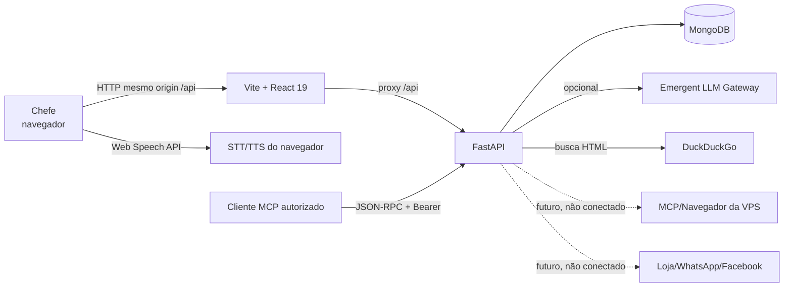
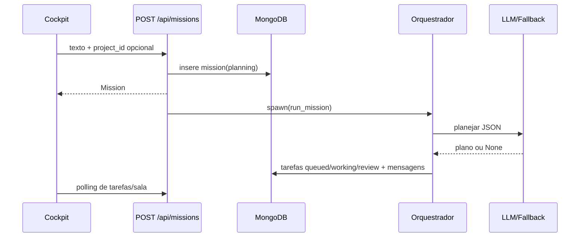

# Arquitetura e dependências

## 1. Visão de contexto

- Fluxo navegador → frontend → API → Mongo: **VERIFICADO NO CODIGO**.
- LLM, DuckDuckGo, voz e MCP: **VERIFICADO NO CODIGO**, disponibilidade externa não garantida.
- Conexões pontilhadas: **DOCUMENTADO/PROPOSTO**, não implementado.

## 2. Estrutura de diretórios

| Caminho | Responsabilidade | Classificação |
|---|---|---|
| `backend/server.py` | bootstrap FastAPI, CORS, lifespan e montagem do `api_router` | VERIFICADO NO CODIGO |
| `backend/models/models.py` | contratos Pydantic v2 | VERIFICADO NO CODIGO |
| `backend/routers/` | endpoints por domínio | VERIFICADO NO CODIGO |
| `backend/lib/db.py` | cliente Mongo compartilhado e índices | VERIFICADO NO CODIGO |
| `backend/lib/orchestrator.py` | missões, tarefas, conversas, memória e briefing | VERIFICADO NO CODIGO |
| `backend/lib/brain.py` | acesso opcional ao gateway de IA e fallback | VERIFICADO NO CODIGO |
| `backend/lib/scheduler.py` | loop de rotina da manhã | VERIFICADO NO CODIGO |
| `backend/lib/search.py` | integração DuckDuckGo | VERIFICADO NO CODIGO |
| `backend/seed.py` | referência inicial idempotente | VERIFICADO NO CODIGO |
| `frontend/src/App.tsx` | tabela de rotas | VERIFICADO NO CODIGO |
| `frontend/src/pages/` | telas do produto | VERIFICADO NO CODIGO |
| `frontend/src/components/` | shell e componentes de domínio | VERIFICADO NO CODIGO |
| `frontend/src/lib/api.ts` | fronteira HTTP tipada manualmente | VERIFICADO NO CODIGO |
| `frontend/src/lib/types.ts` | espelhos TypeScript dos modelos backend | VERIFICADO NO CODIGO |
| `memory/` | SPEC, credenciais de teste e cronograma histórico | DOCUMENTADO |
| `tests/`, `backend/tests/`, `.emergent/scripts/` | infraestrutura e checks gerados | VERIFICADO NO CODIGO |
| `docs/teste-sala-planejamento/` | entregáveis desta análise | EM EXECUCAO DOCUMENTAL |

## 3. Dependências por camada

### Frontend

- React 19, TypeScript estrito e Vite. **DOCUMENTADO** em `README.md`/`TEMPLATE.md`.
- Tailwind v4 e componentes shadcn/base-ui. **DOCUMENTADO**.
- TanStack Query para todas as leituras e mutações do produto. **VERIFICADO NO CODIGO**.
- React Router com um único `BrowserRouter`. **VERIFICADO NO CODIGO**.
- `motion` para animações e `sonner` para notificações. **VERIFICADO NO CODIGO**.
- Web Speech API: dependência do Chrome/navegador, sem serviço externo de voz. **VERIFICADO NO CODIGO**.

### Backend

- FastAPI + Pydantic v2, assíncrono. **DOCUMENTADO e VERIFICADO NO CODIGO**.
- motor/pymongo para MongoDB. **VERIFICADO NO CODIGO**.
- `emergentintegrations` para LLM; ausência de chave não derruba o fluxo. **VERIFICADO NO CODIGO**.
- `httpx` + BeautifulSoup para DuckDuckGo. **VERIFICADO NO CODIGO**.
- `zoneinfo` para America/Sao_Paulo. **VERIFICADO NO CODIGO**.

### Persistência e execução em segundo plano

- Um `AsyncIOMotorClient` compartilhado; índices aplicados em tarefa de startup. **VERIFICADO NO CODIGO**.
- Missões e respostas são disparadas com `asyncio.create_task` encapsulado por `spawn`; referências são mantidas
  somente na memória do processo. **VERIFICADO NO CODIGO**.
- O scheduler é um loop no processo e não uma agenda durável. **VERIFICADO NO CODIGO**.
- Não há broker, fila durável, worker separado, locking distribuído ou reconciliação de jobs. **VERIFICADO NO CODIGO**.

## 4. Fluxos arquiteturais críticos

### 4.1 Missão

Risco: resposta HTTP confirma criação, não conclusão; reinício pode deixar missão incompleta. **VERIFICADO NO CODIGO**.

### 4.2 Revisão

UI envia `PATCH /tasks/{id}/review`; backend lê status, depois atualiza e gera efeitos em projeto, memória e Sala.
O teste sequencial passa, mas a leitura e atualização não são uma única operação condicional. **VERIFICADO NO CODIGO**.
Dois pedidos concorrentes podem duplicar efeitos. **RISCO DEMONSTRÁVEL; teste ainda pendente**.

### 4.3 Briefing

Botão manual chama a API sincronicamente; rotina automática é verificada a cada 30 minutos no processo.
Busca, painel da loja e projetos compõem o contexto; falha do LLM gera briefing simulado. **VERIFICADO NO CODIGO**.

### 4.4 MCP

Servidor stateless aceita `initialize`, `ping`, `tools/list` e `tools/call`; bearer é comparado em tempo constante.
Ferramentas escrevem diretamente nas mesmas coleções do painel. **VERIFICADO NO CODIGO**.

## 5. Dependências específicas do ambiente Emergent

| Dependência | Uso | Portabilidade |
|---|---|---|
| Supervisor no pod | frontend/backend/mongodb | destino precisa substituir ou reproduzir o gerenciamento |
| Proxy Vite `/api` | desenvolvimento/preview | produção precisa servir frontend e API sob mesma origem ou proxy equivalente |
| `emergentintegrations` + chave universal | IA opcional | sem chave, modo simulado continua; fora do ambiente pode exigir integração equivalente autorizada |
| Preview público | validação anterior | não comprova configuração de produção |
| `.emergent/` | checks/cron/infra da plataforma | tratar como metadado específico; não supor portabilidade |

## 6. Origem versus destino

- **Disponível na origem:** processos frontend/backend/Mongo locais, proxy, seed, testes e fallback simulado.
- **Não comprovado no destino:** Mongo gerenciado, persistência de disco, domínio, TLS, secrets, backups, scheduler,
  recursos de voz do cliente, egress para LLM/DDG e integração MCP da VPS.
- **Não exportado pelo código:** dados do banco, segredos, contas autenticadas, sessões de navegador e recursos externos.

## 7. Fronteiras de segurança e dados

- Painel e APIs de negócio estão abertos. **VERIFICADO NO CODIGO**.
- MCP é a única fronteira com token próprio. **VERIFICADO NO CODIGO**.
- Segredos são lidos por variáveis de ambiente; valores não devem entrar no repositório. **VERIFICADO NO CODIGO**.
- Não há propriedade por usuário/organização nem isolamento multitenant. **VERIFICADO NO CODIGO**.
- CORS tem fallback amplo; adequação ao destino é **DECISAO PENDENTE**.

## 8. Mudanças arquiteturais justificadas (não implementadas)

1. **Operações atômicas para revisão/propostas:** resolve duplicidade demonstrável sem trocar stack.
2. **Cron gerenciado/webhook idempotente:** resolve perda do briefing em reinício.
3. **Estado durável de jobs:** necessário antes de tratar missões como execução confiável.
4. **Estados de erro por painel:** evita confundir indisponibilidade com coleção vazia.
5. **Política de backup/restauração:** necessária para qualquer dado operacional real.

Nenhuma mudança de framework ou banco é proposta sem necessidade comprovada.
