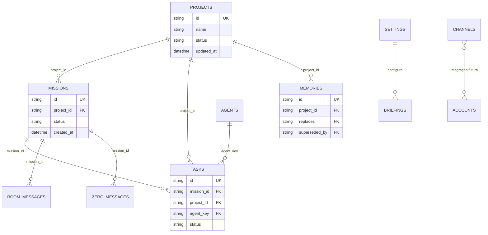

# Mapa do banco de dados

## 1. Mecanismo e estado conhecido

- Mecanismo: **MongoDB documental**, acessado por motor assíncrono. **VERIFICADO NO CODIGO**.
- Banco efetivamente implantado/produção: **não examinado**. **LACUNA**.
- Preview isolado anterior: seed confirmado com 5 agentes, 5 canais, 2 projetos e 4 itens de exemplo;
  regressão 15/15. **VERIFICADO EM EXECUCAO ISOLADA** em `test_reports/iteration_2.json`.
- Validação de documentos no Mongo: não foi identificada. Pydantic valida entradas/saídas HTTP, mas gravações internas
  podem inserir documentos sem schema de banco. **VERIFICADO NO CODIGO**.
- Migrations versionadas: não identificadas. Evolução atual depende de código tolerante + seed/índices. **VERIFICADO NO CODIGO**.

## 2. Relações lógicas

As “FKs” são referências lógicas em strings; Mongo não impõe integridade referencial. **VERIFICADO NO CODIGO**.

## 3. Dicionário de dados existente

### `agents`

Finalidade: registro da hierarquia de agentes. Requisitos: RQ-002.

| Campo | Tipo/formato | Obrigatório/padrão | Regra |
|---|---|---|---|
| `id` | string UUID/seed | sim | identificador público único |
| `key` | string | sim | `zero`, `pro`, `jarvis`, `aluna`, `plus` no seed |
| `name` | string | sim | nome de exibição |
| `role_pt`, `role_en` | string | sim | papel localizado |
| `description_pt`, `description_en` | string | sim | descrição localizada |
| `provider`, `model`, `brain` | string | sim/brain padrão vazio | roteamento e exibição da IA |
| `status` | string | computado na leitura | `idle`/`working` |
| `open_tasks` | inteiro | computado na leitura | tarefas queued/working |
| `created_at` | datetime UTC | sim | BSON retorna naive e é normalizado |

Índices: `id` único; `key` único. Seed faz upsert por `key`.

### `missions`

Finalidade: pedido do Chefe e estado global. Requisitos: RQ-002, RQ-006.

Campos: `id:string` único lógico; `text:string`; `status:planning|delegating|completed|failed`;
`plan_intro:string|null`; `project_id:string|null`; `created_at:datetime UTC`.

Índices: `id` único; `created_at desc`. Exclusão/arquivamento: não definidos. Atualização em background.

### `tasks`

Finalidade: unidades delegadas e entregas revisáveis. Requisitos: RQ-002, RQ-003.

Campos: `id:string`; `mission_id:string`; `mission_text:string`; `agent_key:string`; `title:string`;
`detail:string`; `status:queued|working|review|verified|rejected|failed`; `result:string|null`;
`project_id:string|null`; `review_note:string|null`; `created_at`, `updated_at:datetime UTC`.

Índices: `id` único; `(status, created_at desc)`; `(agent_key, status)`;
`(mission_id, created_at asc)`; `(project_id, updated_at desc)`.

Invariante: somente `review` deve aceitar decisão. A checagem atual não é atômica; CONC-001 cobre a lacuna.

### `room_messages`

Finalidade: narrativa compartilhada. Requisitos: RQ-004.

Campos: `id:string`; `sender_key:user|zero|pro|jarvis|aluna|plus|system`; `kind:string` com usos
`chat|delegation|system|summary|briefing`; `content:string`; `mission_id:string|null`; `created_at:datetime UTC`.

Índices: `id` único; `created_at desc`. Retenção/paginação: limite 200 na API; política de eliminação ausente.

### `zero_messages`

Finalidade: conversa direta e propostas. Requisitos: RQ-004.

Campos: `id:string`; `role:user|zero`; `content:string`; `intent:explicando|propondo|executando|""`;
`proposal:string|null`; `project_id:string|null`; `mission_id:string|null`; `created_at:datetime UTC`.

Índices: `id` único; `created_at asc`. Lacuna: aprovação de proposta lê e atualiza em operações separadas;
CONC-002 cobre duplicidade concorrente.

### `channels`

Finalidade: catálogo/configuração dos canais. Requisitos: RQ-008, RQ-014.

Campos: `id:string`; `key:whatsapp|facebook|internet|visual|mcp`; `name:string`; descrições PT/EN;
`status:connected|disconnected`; `config:objeto string→string`; `updated_at:datetime UTC`.

Índices: `id` único; `key` único. Observação: status “connected” é declarativo para placeholders e não prova conexão.

### `briefings`

Finalidade: histórico da rotina da manhã. Requisitos: RQ-005.

Campos: `id:string`; `day:YYYY-MM-DD America/Sao_Paulo`; `city:string`; `content:string`;
`created_at:datetime UTC`. Índices: `id` único; `created_at desc`.

Invariante pretendida: automático no máximo uma vez por dia; não há índice único em `day` porque execução manual
pode repetir. A idempotência reside no scheduler e não é transacional.

### `settings`

Finalidade: configuração do briefing. Requisitos: RQ-005.

Documento conhecido: `key="briefing"`, `auto:boolean`, `hour:int 0..23`, `city:string até 80`.
Índice: `key` único. Outros documentos são possíveis, mas não documentados.

### `projects`

Finalidade: contexto persistente de retomada. Requisitos: RQ-006.

Campos: `id:string`; `slug:string` apenas nos seeds; `name:string`; `objective:string`;
`status:active|paused|done`; `in_progress`, `blocker`, `next_step`, `last_verified:string`;
`last_verified_at:datetime|null`; `created_at`, `updated_at:datetime UTC`.

Índices: `id` único; `updated_at desc`. Não existe índice/constraint para `slug`; seed consulta por slug antes de inserir.
Não há exclusão de projeto na API.

### `accounts`

Finalidade: catálogo de contas que futuramente poderão alimentar o Navegador Visual. Requisitos: RQ-006, RQ-014.

Campos: `id:string`; `name:string`; `provider:string`; `status:available|busy|offline|unverified`;
`note:string`; `created_at:datetime UTC`. Índice: `id` único. Exclusão é física.

Não armazena senha/token/cookie no modelo observado. Isso deve permanecer uma fronteira de secret store.

### `store_items`

Finalidade: painel AeroPartz. Requisitos: RQ-007.

Campos: `id:string`; `kind:stock|order|coupon`; `title:string`; `detail:string`; `value:string`;
`status:string`; `is_sample:boolean`; `updated_at:datetime UTC`.

Estados: stock `critical|ok`; order `open|done`; coupon `active|expired`.
Índices: `id` único; `(kind,status)`. Exclusão física. Quantidade/valor/código são texto, sem unidade ou decimal formal.

### `memories`

Finalidade: decisões/fatos com origem e histórico. Requisitos: RQ-009.

Campos: `id:string`; `kind:decisao_chefe|fato_verificado|proposta|antiga`; `title:string`;
`content:string`; `source:string`; `project_id:string|null`; `replaces:string|null`;
`superseded_by:string|null`; `created_at:datetime UTC`; `superseded_at` é gravado internamente, mas não consta
no modelo de resposta.

Índices: `id` único; `(project_id,created_at desc)`. Histórico é preservado; não há exclusão.

### `status_checks`

Finalidade: artefato de conectividade do template, sem jornada de produto identificada.
Campos: `id:string`, `client_name:string`, `timestamp:datetime`; índice `timestamp desc`.
Classificação: código ativo, mas **SEM REQUISITO DE PRODUTO**; decidir remoção futura.

## 4. Matriz de acesso atual

| Operação | Navegador anônimo | Cliente MCP com token | Cliente sem token | Observação |
|---|---:|---:|---:|---|
| Ler/escrever missões, tarefas, Sala, projetos, loja, memória e canais via REST | permitido | permitido se chamar REST | permitido | APIs REST não têm autenticação |
| Chamar ferramentas MCP | não pela UI | permitido | negado 401/503 | bearer protege apenas `/api/mcp` |
| Ler `/api/mcp/info` | permitido | permitido | permitido | expõe nomes das ferramentas, não o token |
| Segredos/contas autenticadas | não modelado | não modelado | não modelado | valores devem ficar fora do Mongo/repo |

Não há papéis, organizações ou isolamento por proprietário. **VERIFICADO NO CODIGO**.

## 5. Consultas críticas e índices

| Consulta | Índice atual | Avaliação |
|---|---|---|
| agentes por `key` | unique `key` | adequado |
| missões recentes | `created_at desc` | adequado |
| tarefas por status/recentes | `(status,created_at desc)` | adequado |
| tarefas por agente/status | `(agent_key,status)` | adequado |
| tarefas por missão | `(mission_id,created_at asc)` | adequado |
| tarefas por projeto/recentes | `(project_id,updated_at desc)` | adequado |
| mensagens recentes | `created_at desc` | adequado |
| memória por projeto/recentes | `(project_id,created_at desc)` | adequado |
| projetos por atualização | `updated_at desc` | adequado |
| store por kind/status | `(kind,status)` | adequado ao contexto do Zero |
| projeto seed por `slug` | nenhum | lacuna pequena; risco de duplicidade sob seed concorrente |
| briefing do dia | somente `created_at desc` | suficiente para volume baixo; não garante unicidade automática |

## 6. Estado A/B/C/D

### A. Esquema existente no código

As coleções e campos acima são **VERIFICADOS NO CODIGO**. Não há schema validator no Mongo.

### B. Estado implantado conhecido

Somente o preview isolado da rodada anterior foi validado. Produção e VPS são **NÃO AVALIADAS**.

### C. Evolução proposta

1. Adicionar metadados de controle idempotente para decisões e propostas, sem remover campos.
2. Adicionar coleção durável de jobs/eventos somente se missões precisarem sobreviver a reinícios.
3. Não criar coleção de navegador visual enquanto a etapa documental/pausa do ZERO estiver vigente.
4. Definir retenção, auditoria e backup antes de dados reais de clientes/loja.
5. Se `value` da loja passar a representar dinheiro/quantidade real, separar `amount`, `currency`, `quantity`, `unit`.

### D. Compatibilidade

Mudanças devem ser aditivas, com defaults e leitura tolerante. Índices novos devem ser criados após deduplicação.
Remoções/renomes exigem versão de documento e migração progressiva; rollback destrutivo não é aceitável sem backup.

## 7. Classificação, retenção e volume

| Dado | Classificação proposta | Retenção atual | Decisão necessária |
|---|---|---|---|
| missões/tarefas/mensagens | operacional potencialmente privado | indefinida | prazo, exportação e eliminação |
| memória | decisão/fato potencialmente sensível | histórica sem exclusão | governança e correção |
| loja | operacional comercial | indefinida | origem, atualização e retenção |
| contas | metadado de acesso, sem segredo | indefinida | proprietário e ciclo de vida |
| canal config | pode conter telefone/URL | indefinida | minimização e mascaramento |
| logs | podem incluir IDs/conteúdo em exceções | supervisor | sanitização e prazo |

Volume/crescimento não foram informados; qualquer estimativa seria **HIPOTESE**.
